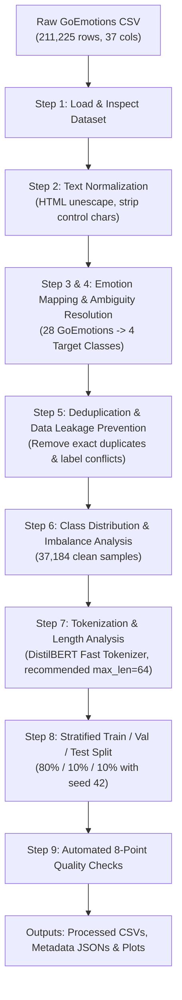

## 📌 Executive Summary

The [`preprocess_goemotions.ipynb`](file:///c:/tempp/projects/Smart%20Mental%20Wellness%20Assistant/preprocess_goemotions.ipynb) notebook implements a data preprocessing and cleaning pipeline for the **Smart Mental Wellness Assistant**. 

It transforms the raw **GoEmotions** dataset (211,225 fine-grained Reddit comments across 28 emotion taxonomy labels) into a 4-class emotion classification dataset target tailored for mental wellness applications:
1. **Joy** (`0`)
2. **Sadness** (`1`)
3. **Anger** (`2`)
4. **Anxiety** (`3`)

The resulting data splits (`train.csv`, `validation.csv`, `test.csv`) are validated and structured for fine-tuning Transformer models such as **DistilBERT** or **BERT**.

---

## 🏗️ Architecture & Pipeline Workflow

---

## 🔍 Detailed Breakdown of Preprocessing Steps

### 1. Setup & Directory Initialization
* **Seed & Reproducibility:** Sets `RANDOM_SEED = 42` across `numpy` and `scikit-learn`.
* **Directories Created:**
  * `data/raw/` – Stores original `goemotions.csv`.
  * `data/processed/` – Stores target CSV files (`train.csv`, `validation.csv`, `test.csv`, `goemotions_4class_clean.csv`).
  * `metadata/` – Stores JSON metadata (`label_mapping.json`, `dataset_statistics.json`, `preprocessing_report.json`).

* **Target Class Definition (`LABEL2ID`):**
  | Emotion Class | Numerical ID | Included GoEmotions Fine-Grained Emotions |
  | :--- | :---: | :--- |
  | **Joy** | `0` | `joy`, `amusement`, `excitement`, `gratitude`, `optimism`, `love`, `pride`, `relief`, `admiration`, `approval`, `caring`, `desire` |
  | **Sadness** | `1` | `sadness`, `grief`, `disappointment`, `remorse`, `embarrassment` |
  | **Anger** | `2` | `anger`, `annoyance`, `disapproval` |
  | **Anxiety** | `3` | `fear`, `nervousness` |
  | *Unmapped* | `-1` | `confusion`, `curiosity`, `disgust`, `realization`, `surprise`, `neutral` |

---

### 2. Dataset Loading & Inspection
* Loads `goemotions.csv` containing **211,225 rows** and **37 columns**.
* **Columns Detected:**
  * **Text column:** `text`
  * **Metadata columns:** `id`, `author`, `subreddit`, `link_id`, `parent_id`, `created_utc`, `rater_id`, `example_very_unclear`.
  * **Fine-grained binary indicators:** 28 columns (`joy`, `sadness`, `anger`, `fear`, `neutral`, etc.).

---

### 3. Text Cleaning & Normalization
Transformer models handle punctuation, casing, and emojis effectively. Therefore, heavy cleaning (like lowercasing or stemming) is avoided to preserve contextual nuances:
* **HTML Unescaping:** Converts `&amp;` $\rightarrow$ `&`, `&gt;` $\rightarrow$ `>`, `&#39;` $\rightarrow$ `'`.
* **Unicode Artifact Correction:** Replaces unicode replacement characters (`\ufffd`) with quotes (`'`).
* **Control Characters:** Normalizes control whitespace characters (`\r`, `\n`, `\t`) into single spaces.
* **Filtering:** Removes empty rows and non-meaningful text lacking alphanumeric characters or shorter than 2 characters (17 non-meaningful rows removed $\rightarrow$ 211,208 remaining).

---

### 4. Emotion Mapping & Multi-Label Ambiguity Resolution
GoEmotions is multi-annotated, meaning a single text can have multiple emotion flags active across different annotators.
* **Single-Label Active Emotion Samples:** 171,811
* **Multi-Label Active Emotion Samples:** 35,994
* **Mapping Strategy:**
  1. **Cleanly Mapped (120,754 samples):** Samples having exactly **one** of the 4 target categories active.
  2. **Ambiguous / Conflicting (8,013 samples removed):** Samples having **more than one** target category active simultaneously (e.g., text marked as both `joy` and `sadness`).
  3. **Unmapped / Neutral (82,441 samples removed):** Samples where none of the 4 target categories are present (texts containing only neutral or unmapped emotions like `curiosity` or `realization`).

---

### 5. Deduplication & Data Leakage Prevention
To prevent train-test data leakage and noise:
1. **Exact Pair Deduplication:** Removes duplicate `(text, label)` rows.
2. **Conflicting Label Filtering:** Identifies and completely removes texts that appear multiple times with conflicting target labels due to opposing annotator ratings (11,063 unique conflicting texts removed).
* **Final Clean Single-Label Dataset:** **37,184 samples**

---

### 6. Class Distribution & Imbalance Analysis
The resulting dataset of 37,184 samples exhibits the following class distribution:

| Class Name | Numerical Label | Sample Count | Percentage (%) |
| :--- | :---: | :---: | :---: |
| **Joy** | `0` | 25,797 | 69.38% |
| **Anger** | `2` | 7,375 | 19.83% |
| **Sadness** | `1` | 3,268 | 8.79% |
| **Anxiety** | `3` | 744 | 2.00% |

* **Total Samples:** 37,184
* **Class Imbalance Ratio:** **34.67 : 1** (Joy vs. Anxiety).
* **Training Recommendations Included:**
  * **Stratified Sampling** (applied during dataset splitting).
  * **Class-Weighted Cross-Entropy Loss** during model training (`CrossEntropyLoss(weight=class_weights)`).
  * **Focal Loss / Oversampling** if minority class recall needs further boosting.

---

### 7. Text Length Analysis & DistilBERT Tokenization
Using HuggingFace's `distilbert-base-uncased` Fast Tokenizer, the notebook calculates subword token sequence lengths:
* **Min Tokens:** 3
* **Max Tokens:** 82
* **Mean Tokens:** 19.11
* **Median Tokens:** 19.0
* **90th Percentile:** 31.0
* **95th Percentile:** 33.0
* **99th Percentile:** 37.0
* **Selection:** Recommends `max_sequence_length = 64`. This covers **> 99%** of all samples without truncating text while avoiding padding overhead.

---

### 8. Stratified Train / Validation / Test Splitting
The clean dataset is partitioned with fixed seed (`42`) and stratification on `label`:
* **Train Set (80%):** 29,747 samples
* **Validation Set (10%):** 3,718 samples
* **Test Set (10%):** 3,719 samples

---

### 9. Automated Quality Verification (8 Checks)
Before saving, the pipeline runs 8 automated quality assertions:
1. ✅ **No missing text** in any split.
2. ✅ **No missing labels** in any split.
3. ✅ **Zero text leakage** (no overlap of texts between train, val, and test).
4. ✅ **Exactly 4 target labels** exist (`Joy`, `Sadness`, `Anger`, `Anxiety`).
5. ✅ **Valid numerical label IDs** (`0, 1, 2, 3`).
6. ✅ **Split proportions** adhere to ~80% / 10% / 10%.
7. ✅ **All 4 classes represented** in every split.
8. ✅ **No test-set contamination**.

---

## 📁 Output Artifacts Summary

Running [`preprocess_goemotions.ipynb`](file:///c:/tempp/projects/Smart%20Mental%20Wellness%20Assistant/preprocess_goemotions.ipynb) produces the following output files:

### Data Files (`data/processed/`)
* [`train.csv`](file:///c:/tempp/projects/Smart%20Mental%20Wellness%20Assistant/data/processed/train.csv) – Training set (29,747 rows)
* [`validation.csv`](file:///c:/tempp/projects/Smart%20Mental%20Wellness%20Assistant/data/processed/validation.csv) – Validation set (3,718 rows)
* [`test.csv`](file:///c:/tempp/projects/Smart%20Mental%20Wellness%20Assistant/data/processed/test.csv) – Test set (3,719 rows)
* [`goemotions_4class_clean.csv`](file:///c:/tempp/projects/Smart%20Mental%20Wellness%20Assistant/data/processed/goemotions_4class_clean.csv) – Complete cleaned 4-class dataset (37,184 rows)

### Metadata Files (`metadata/`)
* `label_mapping.json` – `label2id`, `id2label`, and `goemotions_to_target_mapping`.
* `dataset_statistics.json` – Sample counts, class percentages, token length statistics, and split counts.
* `preprocessing_report.json` – Full audit metrics of initial, filtered, and final sample counts.

### Generated Charts
* [`class_distribution.png`](file:///c:/tempp/projects/Smart%20Mental%20Wellness%20Assistant/class_distribution.png) – Bar chart showing target emotion class distribution.
* [`text_length_distribution.png`](file:///c:/tempp/projects/Smart%20Mental%20Wellness%20Assistant/text_length_distribution.png) – Token length frequency histogram with 95th and 99th percentile cutoffs.
* [`split_distribution.png`](file:///c:/tempp/projects/Smart%20Mental%20Wellness%20Assistant/split_distribution.png) – Comparison chart of class distributions across train, validation, and test splits.