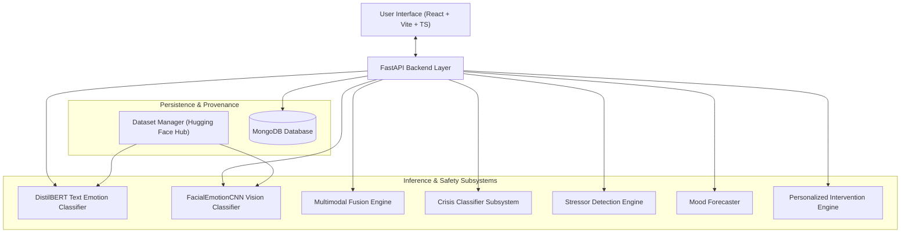

# SMART MENTAL WELLNESS ASSISTANT

Production-quality academic prototype for an **AI-Assisted Multimodal Wellness Platform** combining text emotion recognition, facial-expression analysis, multimodal emotion fusion, crisis screening, stressor detection, longitudinal mood tracking, mood forecasting, personalized CBT-inspired/mindfulness interventions, user feedback learning, explainable AI, and privacy controls.

> [!IMPORTANT]
> **Non-Clinical Disclaimer:** This application provides AI-assisted wellness support and is **not** a medical diagnostic system, therapist, or emergency service. Facial-expression analysis estimates visible facial signals only — it cannot determine a person's true internal emotional state.

---

## 1. Project Overview

The **Smart Mental Wellness Assistant** is built to bridge multimodal perception and personal wellness support. It ingests user check-ins via:
- **Written text** (analyzed via fine-tuned `DistilBERT`)
- **Facial expressions** (analyzed via custom `FacialEmotionCNN`)

The system normalizes these inputs into a common 5-class wellness taxonomy (**Joy, Sadness, Anger, Anxiety, Neutral**), detects contextual domain stressors (Academic, Work, Career, Relationships, etc.), screens for acute distress using a Columbia Suicide Severity Rating Scale (C-SSRS) trained model, forecasts future mood trajectories using daily series statistics, and delivers personalized CBT-inspired or mindfulness-oriented exercises.

---

## 2. Key Features

- **Multimodal Emotion Perceptron:** Configurable weighted fusion ($W_{text} = 0.65, W_{vision} = 0.35$) of text and facial expression signals into a unified wellness estimate.
- **Dynamic Dataset Provenance:** Loads datasets directly from Hugging Face Hub repositories (`SetFit/go_emotions`, `Jeneral/fer-2013`, `av9ash/CSSR-S_labelled_suicidewatch_posts_reddit`) with local caching and runtime structure validation. No hardcoded CSV files.
- **Dedicated Crisis Subsystem:** High-recall C-SSRS distress classifier prioritizing sensitivity to trigger instant safety overrides and present regional crisis hotlines.
- **Contextual Stressor Detection:** Identifies domain context (Academic, Financial, Health, Family, etc.) and intensity level using weighted cue phrase lexicons and intensifiers.
- **Explainable AI (XAI):** Word-level token attributions for text predictions and Grad-CAM visual heatmaps for facial expression analysis.
- **Mood History & Time-Series Forecasting:** Real time-series trend analysis (moving average, trend regression, Holt-Winters) providing 7-day and 14-day forecasts when sufficient historical data exists.
- **Personalized Intervention Engine & Feedback Loop:** CBT-inspired reframing, guided 4-7-8 breathing, 5-4-3-2-1 grounding, and journaling exercises re-ranked dynamically based on stored user feedback.
- **Privacy & Consent Controls:** Zero permanent storage of raw camera frames by default, itemized data export, and single-click history deletion.
- **Real-Time Interactive Dashboard & Web Application:** Built with React 18, Vite, TypeScript, and modern responsive design system.

---

## 3. Architecture Specification



Detailed architectural documentation is available in [`docs/ARCHITECTURE.md`](file:///c:/tempp/projects/clg/ML/Smart%20Mental%20Wellness%20Assistant/docs/ARCHITECTURE.md).

---

## 4. Dataset Sources & Provenance

All datasets are dynamically fetched from the Hugging Face Hub using `datasets.load_dataset()` or the Hub loader:

1. **Text Emotion Dataset:** [`SetFit/go_emotions`](https://huggingface.co/datasets/SetFit/go_emotions) (58,009 Reddit comments mapped to 5 wellness categories).
2. **Computer Vision Dataset:** [`Jeneral/fer-2013`](https://huggingface.co/datasets/Jeneral/fer-2013) (35,887 48x48 grayscale facial expression images across 7 classes).
3. **Crisis Dataset:** [`av9ash/CSSR-S_labelled_suicidewatch_posts_reddit`](https://huggingface.co/datasets/av9ash/CSSR-S_labelled_suicidewatch_posts_reddit) (C-SSRS labeled posts for LOW, MODERATE, and HIGH risk tier screening).

Full dataset documentation is available in [`docs/DATASETS.md`](file:///c:/tempp/projects/clg/ML/Smart%20Mental%20Wellness%20Assistant/docs/DATASETS.md).

---

## 5. Normalized Wellness Taxonomy

Source dataset labels are mapped to a normalized 5-class wellness taxonomy:

| Category ID | Category Name | Source Text Labels (GoEmotions) | Source Vision Expression (FER-2013) |
| :---: | :--- | :--- | :--- |
| `0` | **Joy** | `joy`, `amusement`, `excitement`, `gratitude`, `love`, `optimism`, `pride`, `relief` | `happy` |
| `1` | **Sadness** | `sadness`, `grief`, `disappointment`, `remorse`, `embarrassment` | `sad` |
| `2` | **Anger** | `anger`, `annoyance`, `disapproval` | `angry` |
| `3` | **Anxiety** | `fear`, `nervousness` | `fear` |
| `4` | **Neutral / Other** | `neutral`, `confusion`, `curiosity`, `disgust`, `realization`, `surprise` | `neutral`, `disgust`, `surprise` |

---

## 6. Installation & Prerequisites

### System Requirements
- Python 3.10+
- Node.js 18+ & npm
- MongoDB 6.0+ running locally on port `27017`

### Step 1: Environment Setup
```bash
# Clone and enter workspace
git clone https://github.com/saipraveen-k/Smart-Mental-Wellness-Assistant.git
cd "Smart Mental Wellness Assistant"

# Initialize environment configuration
python scripts/setup.py
```

### Step 2: Install Backend Dependencies
```bash
cd backend
pip install -r requirements.txt
```

### Step 3: Install Frontend Dependencies
```bash
cd ../frontend
npm install
```

---

## 7. Model Training & Evaluation

Model artifacts are stored in `ml/artifacts/`:

```bash
# Train DistilBERT Text Emotion Model (GoEmotions -> Wellness Taxonomy)
python scripts/train_text.py --epochs 2 --batch-size 32

# Train FacialEmotionCNN Computer Vision Model (FER-2013)
python scripts/train_cv.py --epochs 20 --batch-size 128

# Train Crisis Classifier Subsystem (C-SSRS)
python scripts/train_crisis.py

# Evaluate all trained model artifacts and print metrics
python scripts/evaluate.py
```

ML & CV pipeline details are documented in [`docs/ML_PIPELINE.md`](file:///c:/tempp/projects/clg/ML/Smart%20Mental%20Wellness%20Assistant/docs/ML_PIPELINE.md) and [`docs/CV_PIPELINE.md`](file:///c:/tempp/projects/clg/ML/Smart%20Mental%20Wellness%20Assistant/docs/CV_PIPELINE.md).

---

## 8. Running the Application

### Running Backend API Server
```bash
cd backend
uvicorn app.main:app --host 0.0.0.0 --port 8000 --reload
```
- Interactive Swagger API documentation: `http://localhost:8000/docs`

### Running React Frontend
```bash
cd frontend
npm run dev
```
- Open application interface: `http://localhost:5173` (or `http://localhost:3000`)

---

## 9. Automated Testing & Verification

Run the full automated test suite covering unit tests, API router tests, security tests, and multi-step integration flows:

```bash
# Run PyTest suite in backend
cd backend
pytest -v

# Run End-to-End System Health Check
python scripts/health_check.py
```

Testing procedures are documented in [`docs/TESTING.md`](file:///c:/tempp/projects/clg/ML/Smart%20Mental%20Wellness%20Assistant/docs/TESTING.md).

---

## 10. Containerized Deployment (Docker)

Deploy all services (Backend, Frontend, MongoDB) using `docker-compose`:

```bash
# Launch containerized services in detached mode
docker-compose up --build -d

# Check service status
docker-compose ps

# Stop containerized services
docker-compose down
```

Deployment guide is documented in [`docs/DEPLOYMENT.md`](file:///c:/tempp/projects/clg/ML/Smart%20Mental%20Wellness%20Assistant/docs/DEPLOYMENT.md).

---

## 11. Comprehensive Documentation Sitemap

| Document | Description |
| :--- | :--- |
| [`docs/ARCHITECTURE.md`](file:///c:/tempp/projects/clg/ML/Smart%20Mental%20Wellness%20Assistant/docs/ARCHITECTURE.md) | High-level system architecture, component interaction diagrams, taxonomy mappings. |
| [`docs/DATASETS.md`](file:///c:/tempp/projects/clg/ML/Smart%20Mental%20Wellness%20Assistant/docs/DATASETS.md) | Hugging Face dataset IDs, dynamic loading policies, provenance verification, licensing. |
| [`docs/ML_PIPELINE.md`](file:///c:/tempp/projects/clg/ML/Smart%20Mental%20Wellness%20Assistant/docs/ML_PIPELINE.md) | DistilBERT architecture, text preprocessing, token-level XAI, stressor detection rules. |
| [`docs/CV_PIPELINE.md`](file:///c:/tempp/projects/clg/ML/Smart%20Mental%20Wellness%20Assistant/docs/CV_PIPELINE.md) | OpenCV face detection, FacialEmotionCNN architecture, multi-face policy, Grad-CAM. |
| [`docs/API.md`](file:///c:/tempp/projects/clg/ML/Smart%20Mental%20Wellness%20Assistant/docs/API.md) | Complete REST API endpoint reference, request/response schema envelopes, status codes. |
| [`docs/SAFETY.md`](file:///c:/tempp/projects/clg/ML/Smart%20Mental%20Wellness%20Assistant/docs/SAFETY.md) | Safety framework, C-SSRS risk tiering, crisis override protocol, emergency resource directory. |
| [`docs/PRIVACY.md`](file:///c:/tempp/projects/clg/ML/Smart%20Mental%20Wellness%20Assistant/docs/PRIVACY.md) | Consent management, zero-permanent storage of camera frames, data export/purge policy. |
| [`docs/TESTING.md`](file:///c:/tempp/projects/clg/ML/Smart%20Mental%20Wellness%20Assistant/docs/TESTING.md) | Test suite breakdown (Unit, API, Security, Integration) and health check automation. |
| [`docs/DEPLOYMENT.md`](file:///c:/tempp/projects/clg/ML/Smart%20Mental%20Wellness%20Assistant/docs/DEPLOYMENT.md) | Docker Compose specification, environment variable reference, production readiness. |

---

## 12. Safety Limitations & Honest AI Framing

1. **Non-Medical Boundary:** The system does not diagnose mental health conditions or prescribe clinical treatments.
2. **Perception Limitation:** Facial expression analysis measures visible muscular movements, not internal emotional truth.
3. **Crisis Disclaimer:** Crisis screening prioritizes recall but cannot guarantee detection of all distress indicators or replace human intervention.

---

## 13. License & Academic Citation

Academic Prototype — Designed and developed for educational and research exploration in multimodal AI wellness support systems.