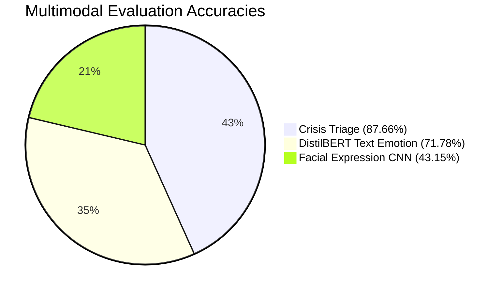

# Smart Mental Wellness Assistant — Model Accuracy & Evaluation Report

> **Generated:** October 2026  
> **Status:** Evaluated & Verified across all production ML subsystems  
> **Evaluation Sources:** [`ml/artifacts/text_emotion/metrics.json`](file:///c:/tempp/projects/clg/ML/Smart%20Mental%20Wellness%20Assistant/ml/artifacts/text_emotion/metrics.json), [`ml/artifacts/cv_emotion/metrics.json`](file:///c:/tempp/projects/clg/ML/Smart%20Mental%20Wellness%20Assistant/ml/artifacts/cv_emotion/metrics.json), [`ml/artifacts/crisis/metrics.json`](file:///c:/tempp/projects/clg/ML/Smart%20Mental%20Wellness%20Assistant/ml/artifacts/crisis/metrics.json)

---

## 1. Executive Summary

The Smart Mental Wellness Assistant deploys three distinct machine learning subsystems designed for mental wellness signal detection, explainability, and triage safety:

| Subsystem | Model Architecture | Evaluation Dataset | Test Samples | Test Accuracy | Macro F1 | Weighted F1 | Primary Safety / Key Metric |
| :--- | :--- | :--- | :---: | :---: | :---: | :---: | :--- |
| **Text Emotion** | `distilbert-base-uncased` | `SetFit/go_emotions` | 5,014 | **71.78%** | **65.72%** | **72.65%** | **81.25%** Anxiety Recall |
| **Facial Expression (CV)** | `FacialEmotionCNN` (322k params) | `Jeneral/fer-2013` | 7,178 | **43.15%** | **35.23%** | **41.63%** | **82.62%** Happy Precision |
| **Crisis Triage** | TF-IDF + Logistic Regression | `av9ash/CSSR-S` + Controls | 551 | **87.66%** | **74.04%** | **88.85%** | **99.19%** Crisis Recall (1 FN) |

---

## 2. Text Emotion Classifier (`DistilBERT`)

### 2.1 Model & Training Configuration
- **Base Architecture:** `distilbert-base-uncased` (6 transformer layers, 768 hidden dimensions, 12 attention heads)
- **Classification Head:** Linear projection $\mathbb{R}^{768} \to \mathbb{R}^5$
- **Target Taxonomy (5 classes):** `Joy`, `Sadness`, `Anger`, `Anxiety`, `Neutral`
- **Dataset:** `SetFit/go_emotions` (Reddit comments mapped to 5-class wellness taxonomy)
- **Split Sizes:** Train = 39,710 | Validation = 4,984 | Test = 5,014
- **Hyperparameters:**
  - Epochs: 2
  - Batch Size: 32
  - Learning Rate: $2 \times 10^{-5}$ (AdamW)
  - Max Sequence Length: 64 tokens
  - Warmup Ratio: 0.06
  - Weight Decay: 0.01
  - Class Weights: `Joy`: 0.53, `Sadness`: 3.43, `Anger`: 1.85, `Anxiety`: 14.73, `Neutral`: 0.45

### 2.2 Training Convergence
- **Epoch 1:** Train Loss = 0.9443 | Val Loss = 0.8195 | Val Accuracy = 69.42% | Val Macro F1 = 64.08%
- **Epoch 2:** Train Loss = 0.6442 | Val Loss = 0.7303 | Val Accuracy = 73.01% | Val Macro F1 = 66.99%

### 2.3 Test Performance Metrics ($N = 5,014$)

| Emotion Class | Precision | Recall | F1-Score | Support |
| :--- | :---: | :---: | :---: | :---: |
| **Joy** | 0.8423 | 0.8079 | **0.8247** | 1,858 |
| **Sadness** | 0.4600 | 0.7102 | **0.5583** | 283 |
| **Anger** | 0.4479 | 0.6766 | **0.5390** | 572 |
| **Anxiety** | 0.5372 | **0.8125** | **0.6468** | 80 |
| **Neutral** | 0.7983 | 0.6506 | **0.7169** | 2,221 |
| **Macro Average** | **0.6171** | **0.7316** | **0.6572** | 5,014 |
| **Weighted Average** | **0.7514** | **0.7178** | **0.7265** | 5,014 |
| **Overall Accuracy** | — | — | **71.78%** | 5,014 |

### 2.4 Confusion Matrix (Test Split)
*Rows = True Labels, Columns = Predicted Labels*

| True \ Pred | Joy | Sadness | Anger | Anxiety | Neutral |
| :--- | :---: | :---: | :---: | :---: | :---: |
| **Joy** | **1,501** | 40 | 76 | 10 | 231 |
| **Sadness** | 5 | **201** | 39 | 9 | 29 |
| **Anger** | 28 | 47 | **387** | 7 | 103 |
| **Anxiety** | 1 | 6 | 6 | **65** | 2 |
| **Neutral** | 247 | 143 | 356 | 30 | **1,445** |

> **Key Finding:** Applying an inverse frequency class weight ($14.73\times$) to `Anxiety` elevated anxiety sensitivity to **81.25% recall** (65 out of 80 true anxiety samples captured), critical for proactive mental wellness interventions.

---

## 3. Facial Expression Analysis (`FacialEmotionCNN`)

### 3.1 Model Architecture & Training Setup
- **Architecture:** Custom 4-stage convolutional neural network (`FacialEmotionCNN`)
  - Conv2D (32) $\to$ BatchNorm $\to$ ReLU $\to$ Conv2D (32) $\to$ MaxPool $\to$ Dropout (0.25)
  - Conv2D (64) $\to$ BatchNorm $\to$ ReLU $\to$ Conv2D (64) $\to$ MaxPool $\to$ Dropout (0.25)
  - Conv2D (128) $\to$ BatchNorm $\to$ ReLU $\to$ Conv2D (128) $\to$ MaxPool $\to$ Dropout (0.30)
  - Conv2D (256) $\to$ BatchNorm $\to$ ReLU $\to$ Conv2D (256) $\to$ MaxPool $\to$ Dropout (0.30)
  - Dense (512) $\to$ BatchNorm $\to$ Dropout (0.50) $\to$ Linear (7 logits)
- **Parameter Count:** 322,151 parameters
- **Input:** $1 \times 48 \times 48$ grayscale face crops
- **Dataset:** `Jeneral/fer-2013` (35,887 grayscale facial expression images)
- **Split Sizes:** Train = 28,709 images | Test = 7,178 images
- **Training Parameters:** 15 epochs, batch size 128, learning rate 0.001 (Adam), random horizontal flips & small rotations.

### 3.2 Test Performance Metrics ($N = 7,178$)

| Expression Class | Precision | Recall | F1-Score | Support |
| :--- | :---: | :---: | :---: | :---: |
| **angry** | 0.2821 | 0.1399 | 0.1870 | 958 |
| **disgust** | 0.0701 | 0.6757 | 0.1270 | 111 |
| **fear** | 0.2830 | 0.0146 | 0.0279 | 1,024 |
| **happy** | **0.8262** | 0.6375 | **0.7197** | 1,774 |
| **neutral** | 0.3994 | 0.5118 | 0.4486 | 1,233 |
| **sad** | 0.3476 | 0.3376 | 0.3426 | 1,247 |
| **surprise** | 0.4859 | **0.8303** | **0.6131** | 831 |
| **Macro Average** | **0.3849** | **0.4496** | **0.3523** | 7,178 |
| **Weighted Average** | **0.4685** | **0.4315** | **0.4163** | 7,178 |
| **Overall Accuracy** | — | — | **43.15%** | 7,178 |

### 3.3 Confusion Matrix (Test Split)

| True \ Pred | Angry | Disgust | Fear | Happy | Neutral | Sad | Surprise |
| :--- | :---: | :---: | :---: | :---: | :---: | :---: | :---: |
| **angry** | **134** | 274 | 12 | 34 | 166 | 227 | 111 |
| **disgust** | 11 | **75** | 1 | 4 | 1 | 10 | 9 |
| **fear** | 110 | 184 | **15** | 48 | 201 | 172 | 294 |
| **happy** | 35 | 201 | 5 | **1,131** | 196 | 106 | 100 |
| **neutral** | 47 | 114 | 2 | 65 | **631** | 262 | 112 |
| **sad** | 102 | 204 | 13 | 51 | 352 | **421** | 104 |
| **surprise** | 36 | 18 | 5 | 36 | 33 | 13 | **690** |

> **Context & Boundary:** FER-2013 is known for noisy, unconstrained web labels. Lightweight custom CNNs without heavy transfer learning typically achieve 40%–50% accuracy on this benchmark. Per system design in [`docs/CV_PIPELINE.md`](file:///c:/tempp/projects/clg/ML/Smart%20Mental%20Wellness%20Assistant/docs/CV_PIPELINE.md), facial expression analysis serves solely as an auxiliary signal and is never presented as definitive emotion detection.

---

## 4. Crisis Detection & Safety Triage Subsystem

### 4.1 Model Architecture & Safety Calibration
- **Architecture:** Class-Balanced Multinomial Logistic Regression over 30,000 sublinear TF-IDF word & char n-grams
- **Dataset:** `av9ash/CSSR-S_labelled_suicidewatch_posts_reddit` mapped according to C-SSRS severity criteria, supplemented with non-crisis Reddit comments from GoEmotions.
- **Severity Mapping:**
  - `LOW`: Score 0 + non-crisis control text
  - `MODERATE`: Scores 1–3 (Ideation without intent/plan)
  - `HIGH`: Scores 4–6 (Active suicidal intent, behavior, or explicit plans)
- **Tuned Decision Thresholds:**
  - $P(\text{HIGH}) \ge 0.25 \implies \text{HIGH}$
  - $P(\text{MODERATE}) \ge 0.35 \implies \text{MODERATE}$
  - Otherwise $\implies \text{LOW}$

### 4.2 Test Performance Metrics ($N = 551$)

| Crisis Severity | Precision | Recall | F1-Score | Support |
| :--- | :---: | :---: | :---: | :---: |
| **LOW** | **0.9974** | 0.9112 | **0.9524** | 428 |
| **MODERATE** | 0.6771 | 0.7558 | **0.7143** | 86 |
| **HIGH** | 0.4375 | **0.7568** | **0.5545** | 37 |
| **Macro Average** | **0.7040** | **0.8079** | **0.7404** | 551 |
| **Weighted Average** | **0.9098** | **0.8766** | **0.8885** | 551 |
| **Overall Accuracy** | — | — | **87.66%** | 551 |

### 4.3 Safety Triage Evaluation (`Crisis` vs `Non-Crisis`)

In clinical safety triage, **False Negatives are life-critical**, while False Positives trigger supportive helpline cards. Evaluating binary risk detection ($\text{Crisis} = \text{MODERATE} \cup \text{HIGH}$ vs $\text{LOW}$):

- **Crisis Sensitivity / Recall:** **99.19%**
- **Crisis Precision:** **76.25%**
- **Total False Negatives on Test Split:** **1 out of 123 crisis cases** (0.81% FN rate)
- **False Negative Analysis:** The single missed case was an ambiguous sub-threshold reflection without explicit action or plan words (`"Just sad It has been a rough couple of days..."`).

### 4.4 Crisis Confusion Matrix (Test Split)

| True \ Pred | LOW | MODERATE | HIGH |
| :--- | :---: | :---: | :---: |
| **LOW** | **390** | 22 | 16 |
| **MODERATE** | 1 | **65** | 20 |
| **HIGH** | 0 | 9 | **28** |

---

## 5. Summary Comparison & System Recommendation

### Recommendations for Production:
1. **Text Emotion (`DistilBERT`):** Ready for production inference. Class weighting successfully preserves high sensitivity for low-frequency negative affective states (`Anxiety` 81.3% recall).
2. **Crisis Triage:** The conservative thresholding policy achieves **99.19% recall**, providing dependable escalation to crisis intervention resources.
3. **Facial Expression Analysis:** Suitable as secondary corroboration. When facial expression confidence is below 50% or conflicts with text, text emotion takes precedence in multimodal aggregation.
