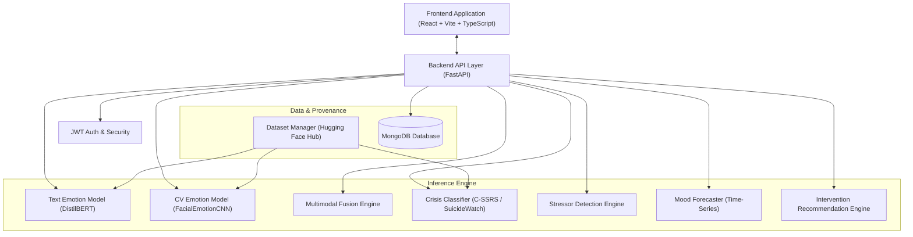

# Smart Mental Wellness Assistant — Architecture Specification

## System Overview

The **Smart Mental Wellness Assistant** is an AI-assisted multimodal wellness platform designed to estimate emotional signals from user-written text and facial expressions, screen for acute distress/crisis, detect potential life stressors, track longitudinal mood trends, forecast future mood trajectories, and deliver personalized CBT-inspired and mindfulness interventions.

> [!IMPORTANT]
> **Non-Clinical Disclaimer:** This application provides AI-assisted wellness support and is **not** a medical diagnostic system, therapist, or emergency service. Facial-expression analysis estimates visible expressions only — it cannot determine a person's true internal emotional state.

---

## High-Level System Architecture

---

## Core Technical Layers

### 1. Presentation Layer (Frontend)
- **Framework:** React 18 + Vite + TypeScript.
- **Styling:** Custom CSS design system with light/dark theme support, glassmorphism, responsive grid, dynamic charts (Recharts), webcam feed controls, and accessibility features.
- **Key Modules:**
  - Dashboard: Instant wellness state summary & quick check-in.
  - Chat/Assistant: Real-time multimodal input, stressor breakdown, explainability tags, and safety banners.
  - Camera/Vision: Canvas webcam capture, face detection preview, uploaded image analysis, and confidence breakdown.
  - Mood History & Forecasting: Interactive trends, emotion distribution, 7/14-day forecasts.
  - Wellness Center: Guided breathing, CBT reframing, journaling, and reflection exercises.
  - Privacy & Consent: Data export, itemized deletion, camera permission management.

### 2. Service & API Layer (Backend)
- **Framework:** FastAPI with Uvicorn.
- **Authentication:** JWT tokens, bcrypt password hashing, CORS protection, rate-limiting (slowapi).
- **Structure:**
  - `app/api/`: Endpoint routers for auth, chat, emotion, vision, multimodal, crisis, stressor, mood, forecast, interventions, datasets, privacy, and system status.
  - `app/services/`: Service orchestrators (`ModelManager`, `TextService`, `VisionService`, `FusionService`, `InterventionService`, `WellnessService`).

### 3. Machine Learning & Computer Vision Subsystem
- **Text Emotion Classifier:** Fine-tuned `distilbert-base-uncased` mapped to the normalized 5-class wellness taxonomy (Joy, Sadness, Anger, Anxiety, Neutral).
- **Facial Expression Classifier:** Custom 4-stage convolutional neural network (`FacialEmotionCNN`) trained on FER-2013 48x48 grayscale faces, mapping 7 raw classes to normalized wellness categories.
- **Multimodal Fusion:** Configurable weighted combination of text and vision probability distributions (`TEXT_MODALITY_WEIGHT = 0.65`, `VISION_MODALITY_WEIGHT = 0.35`).
- **Crisis Detection Subsystem:** High-recall TF-IDF + Logistic Regression ensemble trained on C-SSRS labeled posts and control datasets, providing conservative 3-tier risk levels (LOW, MODERATE, HIGH) and triggering safety overrides.
- **Stressor Detection Subsystem:** Rule-enhanced multi-label NLP classifier identifying life context (Academic, Career, Relationships, Family, Financial, Health, Sleep, Social, Work, Other).

### 4. Database Layer (Persistence & Privacy)
- **Database:** MongoDB 8.x.
- **Collections:** `users`, `mood_records`, `interventions`, `feedback`, `crisis_events`, `model_predictions`, `dataset_runs`, `audit_logs`.
- **Privacy Policy:** No raw webcam image frames are stored by default; temporary buffers are discarded immediately after inference. Data retention respects user consent settings.

---

## Normalized Wellness Taxonomy

| Raw GoEmotions Label Cluster | Raw FER-2013 Label | Normalized Category | Category ID |
| :--- | :--- | :--- | :---: |
| `joy`, `amusement`, `excitement`, `pride` | `happy` | **Joy** | 0 |
| `sadness`, `grief`, `disappointment`, `remorse` | `sad` | **Sadness** | 1 |
| `anger`, `annoyance`, `disapproval`, `furious` | `angry` | **Anger** | 2 |
| `fear`, `nervousness`, `anxiety`, `embarrassment` | `fear` | **Anxiety** | 3 |
| `neutral`, `realization`, `curiosity` | `neutral`, `disgust`, `surprise` | **Neutral / Other** | 4 |

---

## Scalability & Deployment Architecture

- **Containerization:** Multi-stage Dockerfiles for backend and frontend orchestrated with `docker-compose.yml`.
- **Hardware Acceleration:** Automatic fallback from CUDA GPU acceleration to CPU multi-threaded execution.
- **Dynamic Dataset Provenance:** Dynamic loading from Hugging Face Hub with local caching in `.hf_cache` and runtime dataset validation.
